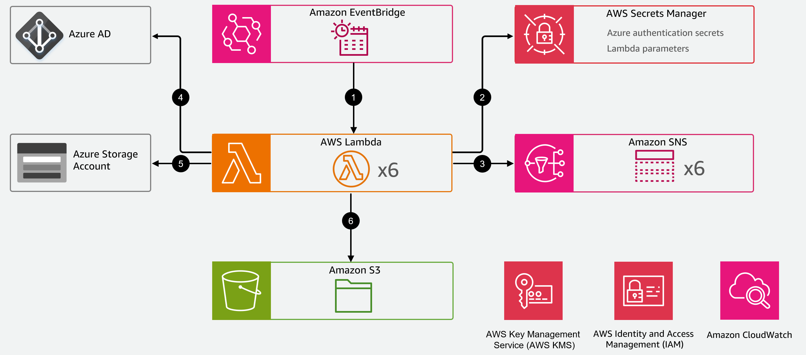
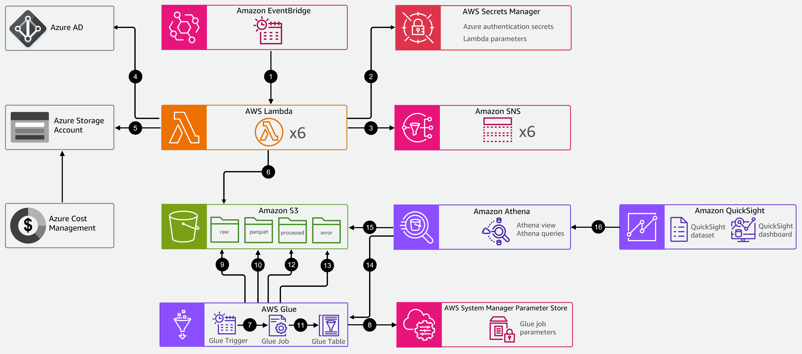

Welcome! This repository contains two projects.

1. [Azure blob to Amazon S3 Copy](#azure-blob-to-amazon-s3-copy)
2. [Cloud intelligence Dashboard for Azure Standard and FOCUS exports](#cloud-intelligence-dashboard-for-azure-standard-and-focus-exports)
- [Contributing](#contributing)
- [License](#license)

---

## Azure blob to Amazon S3 Copy

For an introduction refer to [How to copy data from Azure Blob Storage to Amazon S3 using code](https://aws.amazon.com/blogs/modernizing-with-aws/azure-blob-to-amazon-s3/).



To deploy using AWS **CloudFormation**, follow instructions in the [blog post](https://aws.amazon.com/blogs/modernizing-with-aws/azure-blob-to-amazon-s3/).

To deploy using **Terraform** follow the instructions below.

1. Download / Clone repository

2. Locally, maintain the folder structure as is, and execute Terraform builds from the TF directory. Both the TF and CFN folders are necessary.

3. You can use the [example](https://github.com/aws-samples/aws-data-pipelines-for-azure-storage/tree/main/AzureblobtoAmazonS3copy/TF/AzureExample) in the *AzureblobtoAmazonS3copy* folder to configure an Azure Storage account. Just move the files to the AzureblobtoAmazonS3copy/TF directory. If you decide to use this method, please edit the specified lines in *azs3copy-aws.tf* as below:

```
## NOTE: Comment out these lines if deploying Azure Example
#resource "aws_secretsmanager_secret_version" "SecretsManagerSecret" {
#  secret_id = aws_secretsmanager_secret.SecretsManagerSecret.id
#  secret_string = jsonencode({
#    bloburl     = var.AzureBlobURL 
#    tenantid    = var.AzureTenantID
#    appid       = var.AzureApplicationID
#    appsecret   = var.AzureSecretKey
#    bucket_name = "${aws_s3_bucket.S3Bucket.bucket}"
#    isactive    = "True"
#    begindate   = var.BlobToS3SyncStartDate
#    sns_arn_l1  = "${aws_sns_topic.SNSTopicL1L2.arn}"
#    sns_arn_l2  = "${aws_sns_topic.SNSTopicL2L3.arn}"
#    sns_arn_l3  = "${aws_sns_topic.SNSTopicLargeFileInit.arn}"
#    sns_arn_l4  = "${aws_sns_topic.SNSTopicLargeFilePart.arn}"
#    sns_arn_l5  = "${aws_sns_topic.SNSTopicLargeFileRecomb.arn}"
#  })
#}

# NOTE: Uncomment these lines if deploying Azure Example
 resource "aws_secretsmanager_secret_version" "SecretsManagerSecret" {
   secret_id = aws_secretsmanager_secret.SecretsManagerSecret.id
   secret_string = jsonencode({
     bloburl     = azurerm_storage_account.StorageAccount.primary_blob_endpoint
     tenantid    = data.azurerm_client_config.current.tenant_id
     appid       = azuread_application.AppRegistration.application_id
     appsecret   = azuread_application_password.AppPassword.value
     bucket_name = "${aws_s3_bucket.S3Bucket.bucket}"
     isactive    = "True"
     begindate   = var.BlobToS3SyncStartDate
     sns_arn_l1  = "${aws_sns_topic.SNSTopicL1L2.arn}"
     sns_arn_l2  = "${aws_sns_topic.SNSTopicL2L3.arn}"
     sns_arn_l3  = "${aws_sns_topic.SNSTopicLargeFileInit.arn}"
     sns_arn_l4  = "${aws_sns_topic.SNSTopicLargeFilePart.arn}"
     sns_arn_l5  = "${aws_sns_topic.SNSTopicLargeFileRecomb.arn}"
   })
 }
```

4. Configure `terraform.tfvars`. Refer to descriptions in `variables-aws.tf` for help.

5. Modify *main-aws.tf* to include an appropriate profile or make changes to match your preferred deployment configuration.

6. Run `terraform apply` from the *AzureblobtoAmazonS3copy/TF* directory. 

---

## Cloud intelligence Dashboard for Azure (Standard and FOCUS exports)

For an introduction refer to [How to view Azure costs using Amazon QuickSight](https://aws.amazon.com/blogs/modernizing-with-aws/cloud-intelligence-dashboard-for-azure/)



To deploy using Cloudformation or Terraform, follow instructions in the [Cloud Intelligence Dashboard for Azure workshop](https://catalog.workshops.aws/cidforazure).

To understand how the Azure Cost Usage files should be provided, take a look at the dataset examples download [here](https://microsoft.github.io/finops-toolkit/open-data#download-open-data).

### Sign in to Microsoft Entra ID without a client secret (optional)

By default the Lambda functions sign in to Microsoft Entra ID with the app registration's client secret, stored in AWS Secrets Manager. Set `AzureAuthMethod` to `FederatedIdentity` to store no Azure credential at all. The Lambda execution role then gets a short-lived token from AWS STS ([IAM outbound identity federation](https://docs.aws.amazon.com/IAM/latest/UserGuide/id_roles_providers_outbound.html)), and Entra ID trusts it through a [federated identity credential](https://learn.microsoft.com/en-us/entra/workload-id/workload-identity-federation). There is no secret to store, rotate or let expire.

1. Enable outbound identity federation once in the AWS account, and note the issuer URL:

   ```
   aws iam enable-outbound-web-identity-federation
   aws iam get-outbound-web-identity-federation-info --query IssuerIdentifier --output text
   ```

2. Deploy with `AzureAuthMethod` set to `FederatedIdentity` (CloudFormation parameter, or `terraform.tfvars`). `AzureSecretKey` is not used. Upload the updated Lambda zip files to your source bucket first.

3. Add a federated identity credential to the Entra ID app registration. Use the issuer from step 1, and the Lambda role ARN from the `AzureFederatedCredentialSubject` stack output (Terraform: `azure_federated_credential_subject`):

   ```
   az ad app federated-credential create --id <AzureApplicationID> --parameters '{
     "name": "cid-azure-lambda",
     "issuer": "<IssuerIdentifier>",
     "subject": "arn:aws:iam::<account-id>:role/<PrefixCode>iar<EnvironmentCode>cidazurelambda",
     "audiences": ["api://AzureADTokenExchange"]
   }'
   ```

4. If you are switching an existing deployment, delete the app registration's client secret after the next successful copy (`az ad app credential delete`).

The app registration keeps its existing role on the storage account (for example *Storage Blob Data Reader*).

---

## Contributing

See [CONTRIBUTING](CONTRIBUTING.md#security-issue-notifications) for more information.

---

## License

This library is licensed under the MIT-0 License. See the [LICENSE](https://github.com/aws-samples/aws-data-pipelines-for-azure-storage/blob/main/LICENSE) file.

---